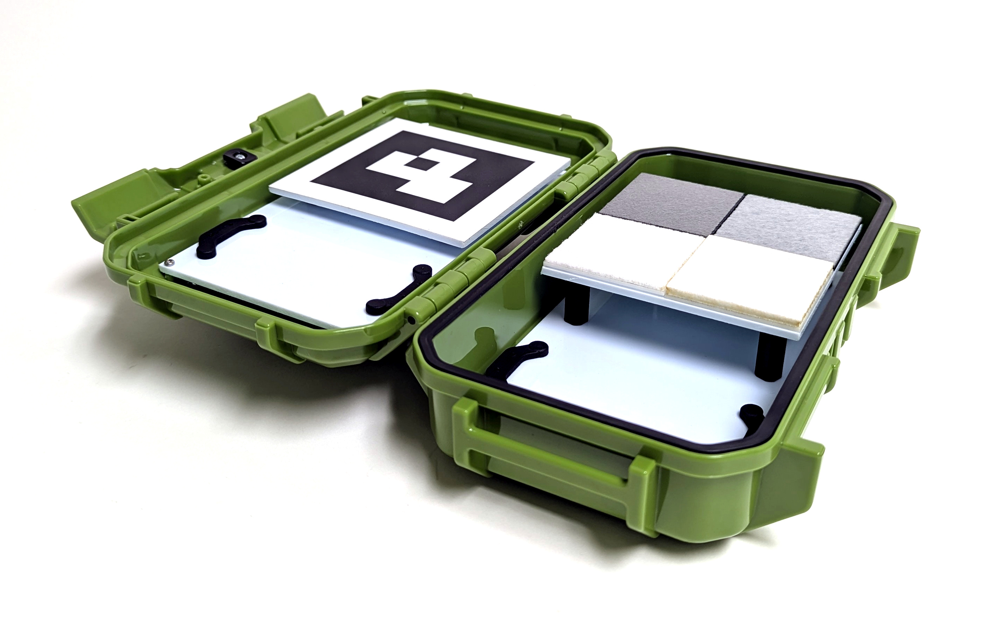

# Kalibrierungsstandards

MAPIR bietet verschiedene Kalibrierungsstandards für eine Vielzahl von Anwendungen an. Das unten abgebildete kompakte Modell T4-R50 enthält vier Platten, deren Lichtreflexion im Bereich von 250 bis 2.500 nm gemessen wurde.

<figure><figcaption>
MAPIR T4-R50
</figcaption></figure>Die diffusen Referenztargets T4 weisen die folgenden Reflexionskurven auf, [Daten hier herunterladen](https://cdn.shopify.com/s/files/1/0972/5566/files/MAPIR_Diffuse_Reflectance_Standard_Calibration_Target_Data_T4.xlsx?v=1741759157):

<figure><figcaption>
MAPIR T4-Reflexionsgrad :: 250–2.500 nm
</figcaption></figure>

<figure><figcaption>
MAPIR T4-Reflexionsgrad :: 400–1.000 nm
</figcaption></figure>Die T4P-Diffusreferenztargets weisen die folgenden Reflexionskurven auf, [Daten hier herunterladen](https://cdn.shopify.com/s/files/1/0972/5566/files/MAPIR_Diffuse_Reflectance_Standard_Calibration_Target_Data_T4.xlsx?v=1741759157):

<figure><figcaption>
MAPIR T4P-Reflexionsgrad :: 250–2500 nm
</figcaption></figure>

<figure><figcaption>
MAPIR T4P-Reflexionsgrad :: 400–1000 nm
</figcaption></figure>Wenn Sie sich das Reflexionsdiagramm ansehen, erkennen Sie, dass die Werte die Wellenlänge (x-Achse) im Verhältnis zum Reflexionsprozentsatz (y-Achse) darstellen. Wenn wir ein Bild des Kalibrierungsziels aufnehmen, erstellen wir eine Beziehung zwischen dem Pixelwert und dem Reflexionsprozentsatz innerhalb des Spektrums, für das jedes der Sensor-Bänder der Kamera empfindlich ist.

Das bedeutet, dass Sie bei jedem Bild, das Sie mit unseren Kameras aufnehmen, ein Foto unserer Reflektanztargets wie beispielsweise das [T4-R50](https://www.mapir.camera/collections/calibration-targets/products/diffuse-reflectance-standard-calibration-target-package-t3-r50) oder das [T4-R125](https://www.mapir.camera/collections/multispectral-reflectance-reference-calibration-targets/products/diffuse-reflectance-standard-calibration-target-package-t4-r125) verwenden können, um die Bilder hinsichtlich der Reflektanz zu kalibrieren. Nach der Kalibrierung entspricht jedes Pixel im Bild einem Reflexionsprozentsatz.

Wenn Sie die kalibrierten Bilder in Chloros als typisches JPG oder TIFF ausgeben, wird der Reflexionsprozentsatz berechnet, indem der Pixelwert durch die Bittiefe des Bildformats geteilt wird. Bei JPG dividieren Sie also durch 255 und bei TIFF durch 65.535. Sie können auch das PERCENT-Ausgabeformat in Chloros wählen; dann liegt jeder Pixelwert im Bereich von 0,0 bis 1,0 (0 % bis 100 % Reflexionsgrad). Beachten Sie jedoch, dass einige Bildbearbeitungsprogramme keine Bilder im Prozentformat (Gleitkomma) verarbeiten können und diese zudem viel Speicherplatz beanspruchen.

<figure><figcaption>
T4-R125
</figcaption></figure> <figure><figcaption>
T4-R125
</figcaption></figure> <figure><figcaption>
T4-R125
</figcaption></figure>

