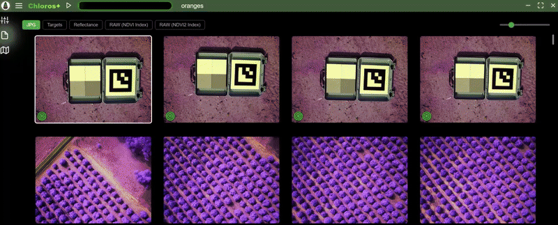

# Bildraster

Nachdem Sie Bilder in ein Projekt importiert haben, werden diese im Hauptbereich in einem Raster angeordnet angezeigt. Im Raster wählen Sie aus, **welche Version jedes Bildes Sie gerade betrachten** – mit den Schaltflächen darüber können Sie alle Miniaturansichten gleichzeitig zwischen den Quelldateien und den jeweiligen bearbeiteten Ergebnissen umschalten.

## Größe der Miniaturansichten

Verwenden Sie den Zoom-Schieberegler oben rechts, um die Größe der Bild-Miniaturansichten anzupassen. Der Schieberegler reicht von **64 px bis 1200 px**.

* **Strg + Mausrad** skaliert die Miniaturansichten ebenfalls.
* **Strg + `+`**/**Strg + `=`**und**Strg + `−`** ändern die Größe schrittweise um 4 px pro Tastendruck. Der Tastaturbefehlsbereich endet am unteren Ende bei 64 px und am oberen Ende bei der Größe, bei der genau zwei Miniaturansichten pro Zeile im aktuellen Fenster Platz finden.
* Die von Ihnen gewählte Größe wird mit dem Projekt gespeichert (`UI → Grid thumbnail size` in `project.json`, Standard `160`), sodass sie beim erneuten Öffnen des Projekts wiederhergestellt wird.

<figure><figcaption></figcaption></figure>Die *Auflösung* der Miniaturansichten ist eine von der *Größe* der Miniaturansichten unabhängige Einstellung: siehe **Anzeige → Auflösung der Bildminiaturansichten** in den [Projekteinstellungen](../project-settings/project-settings.md) (Standardwert 512 px an der langen Seite). Die Größe gibt an, wie groß die Kachel gezeichnet wird; die Auflösung gibt an, wie viele Details zum Ausfüllen der Kachel abgerufen werden.

***

## Die Raster-Symbolleiste

Die Schaltflächenreihe oberhalb des Rasters umfasst von links nach rechts bis zu drei Gruppen:

1. **Pro Trigger / Pro Kamera** – Gruppierungsmodus. Wird nur bei Projekten angezeigt, die LATTICE-Aufnahmen enthalten.
2. **Kamerafilter-Schaltflächen** – eine pro LATTICE-Kamera. Werden nur im Modus „Pro Kamera“ angezeigt.
3. **Schaltflächen für Export-/Anzeigemodus** – legen fest, welches Produkt jedes Miniaturbild anzeigt.

Wenn das Fenster für alle Schaltflächen zu schmal ist, werden die Gruppen von rechts nach links zu Dropdown-Menüs beim Darüberfahren mit der Maus ausgeblendet: Zuerst werden die Export-/Ansichts-Schaltflächen ausgeblendet, dann die Kamera-Schaltflächen. Die ausgeblendete Gruppe hinterlässt eine einzige Schaltfläche, die mit der aktuell aktiven Auswahl beschriftet ist; wenn man mit der Maus darüberfährt, wird der gesamte Satz nach unten geschoben. **„Pro Auslöser“ / „Pro Kamera“ werden niemals ausgeblendet.

<!-- SCREENSHOT-NEEDED: Image grid toolbar of a LATTICE array project at full width, showing all three button groups inline: Per Trigger / Per Camera, three camera filter buttons labelled "LATT-M3M (serial)", and the export/view buttons including TIFF, RAW (Original), RAW (Radiance), RAW (Reflectance). -->

*****

## Schaltflächen für Exportansicht

Diese Schaltflächen wechseln die Miniaturansichten im Raster zwischen verschiedenen Bildtypen. **Eine Schaltfläche erscheint, sobald das Produkt, dessen Namen sie trägt, vorhanden ist** – was bei den Quelldateien bedeutet: unmittelbar beim Import, nicht erst nach der Verarbeitung. Chloros scannt die Produkte des Projekts während eines laufenden Durchlaufs erneut, sodass die Schaltflächen während der Verarbeitung erscheinen, sobald die einzelnen Produkte auf der Festplatte gespeichert werden.

### Die Basisschaltfläche

Die Exportschaltfläche ganz links ist mit **dem, was Sie tatsächlich importiert haben** beschriftet:

| Was Sie importiert haben | Beschriftung der Schaltfläche |
| --- | --- |
| Survey3 RAW+JPG | `JPG` |
| LATTICE-Aufnahmen mit einer Vorschau neben dem RAW-Bild | `PNG` oder `TIFF`, je nachdem, welche Vorschaubilder vorhanden sind |
| LATTICE-Aufnahmen, bei denen die Basisdatei **das** RAW-Bild ist | *keine Schaltfläche* – `RAW (Original)` zeigt diese Datei bereits an |

In einem gemischten Projekt richtet sich die Beschriftung nach der Dateiendung, die bei den meisten Bildern verwendet wird.

### Produktschaltflächen

| Schaltfläche | Zeigt an | Wann sie erscheint |
| --- | --- | --- |
| **Ziele** | Bilder mit einem erkannten Kalibrierungsziel | Nach einem Durchlauf, bei dem Ziele erkannt wurden |
| **Reflexionsgrad** | Kalibrierte Reflexionsgradbilder | Nur bei Survey3-Projekten – LATTICE-Projekte verwenden stattdessen `RAW (Reflectance)`, sodass im Raster niemals zwei Reflexionsgrad-Schaltflächen angezeigt werden |
| **Weißabgleich** | Das Produkt mit Weißabgleich (RGB-Kameras) | Nach der Verarbeitung |
| **Vignettierungskorrektur** | Der unkalibrierte Fallback mit Vignettierungskorrektur | Nach einem Durchlauf, bei dem keine Reflektanzkalibrierung angewendet werden konnte und die *Vignettierungskorrektur* aktiviert war |
| **Sensorkennlinie** | Die unkalibrierte Fallback-Variante mit Sensorkennlinie | Wie oben, jedoch mit deaktivierter *Vignettierungskorrektur* |
| **`RAW (<INDEX> Index)`** | Eine Schaltfläche pro berechnetem Index | Nach einem Durchlauf mit konfigurierten Indizes |
| **`<INDEX> LUT`** | Eine Schaltfläche pro farbabgebildetem Index | Nach einem Durchlauf mit konfigurierter LUT |
| **`<Index> <Index\|LUT> <NNN>`** | Eine Schaltfläche pro Exportlauf der [Index/LUT-Sandbox](index-lut-sandbox.md) | Sobald ein Sandbox-Export abgeschlossen ist |

### Schaltflächen auf LATTICE-Ebene

Projekte, die LATTICE-Aufnahmen enthalten, fügen diese hinzu, die mit dem Namen der Ebene statt mit einem Produktnamen beschriftet sind:

| Schaltfläche | Ebene |
| --- | --- |
| **RAW (Original)** | Das importierte Rohbild |
| **RAW (Strahlungsintensität)** | Spektrale Strahlungsintensität als Float32, W/m²/sr/nm |
| **RAW (Reflexionsgrad)** | Reflexionsgrad als uint16, 32768 = ρ 1,0 |

`RAW (Original)` ist ab dem Zeitpunkt des Imports verfügbar – es bedarf keiner weiteren Verarbeitung. Wenn ein LATTICE-Import überhaupt keine Basis-Schaltfläche hat (die Basisdatei jeder Aufnahme ist ihr Rohbild), verschiebt sich das Raster automatisch zur ersten verfügbaren Ebenen-Schaltfläche, sodass die Hervorhebung in der Symbolleiste mit dem übereinstimmt, was Sie sehen.

Chloros-Exporte mit zwei Ebenen erhalten **keine eigene Raster-Schaltfläche**:

* **Debayered** – Die `RAW (Original)`-Ansicht wird bereits debayered gerendert, daher wäre eine zweite Schaltfläche für ein optisch identisches Bild überflüssig. Das `RAW (Debayered)`-Produkt wird weiterhin auf die Festplatte geschrieben und ist nach wie vor über das Dropdown-Menü der Vollbild-Ebenen auswählbar.
* **Vorschau** — bei RGB-Kameras wird die Vorschau als `White Balanced`-Ebene registriert, die über eine Schaltfläche verfügt. Bei Multispektralkameras wird sie als „`RAW (Preview)`“ registriert und ist über das Dropdown-Menü der Vollbild-Ebenen erreichbar.


Diese Ebenen-Schaltflächen werden nur für Projekte gerendert, die tatsächlich LATTICE-Frames enthalten. Survey3-Projekte registrieren teilweise dieselben internen Ebenenbezeichnungen, und die Schaltflächen werden für diese herausgefiltert, sodass ein Survey3-Raster seinen gewohnten `JPG / Targets / Reflectance`-Satz beibehält.


Ein Klick auf eine Raster-Miniaturansicht öffnet den Vollbild-[Bildbetrachter](opening-an-image-full-screen.md) für **das gleiche Produkt, das das Raster anzeigt** – ist das Raster auf `Targets` eingestellt, öffnet die Miniaturansicht das exportierte Zielbild.

<figure><figcaption></figcaption></figure>
<!-- SCREENSHOT-UPDATE: This GIF predates the LATTICE level buttons and the toolbar group separators. Reshoot on a LATTICE project cycling base -> RAW (Original) -> RAW (Radiance) -> RAW (Reflectance) -> an index button, so the new button set and the level names are visible. -->

***

## Gruppierung eines LATTICE-Projekts: Nach Trigger vs. nach Kamera

Array-Aufnahmen erzeugen mehrere Bilder desselben Augenblicks von verschiedenen Kameramodulen. Die Gruppierung legt fest, wie das Raster diese Bilder anordnet. Beide Modi zeigen zusammenklappbare Kopfzeilen in voller Breite an; **jede Gruppe ist zunächst erweitert**, und Chloros merkt sich, welche Sie schließen. Der Zusammenklappstatus wird pro Modus separat verfolgt, sodass das Schließen einer Gruppe im Modus „Pro Kamera“ keine Auswirkungen auf den Modus „Pro Auslöser“ hat.

### „Pro Kamera“ (Standard)

Eine Gruppe pro Kameramodul. Die Kopfzeile zeigt das Kameramodell und die Seriennummer (`LATT-M3M — <serial>`) sowie die Anzahl der Fotos an. Die Kacheln innerhalb einer Gruppe sind chronologisch nach Aufnahmezeitpunkt sortiert.

In diesem Modus erhält die Symbolleiste außerdem eine **Kamera-Filter-Schaltfläche pro Kamera** mit der Bezeichnung `MODEL (SERIAL)`. Alle Kameras sind zunächst ausgewählt; durch Klicken auf eine Schaltfläche wird die Auswahl dieser Kamera aufgehoben und ihre Gruppe aus dem Raster entfernt. Dies ist die schnelle Methode, um ein Band über einen gesamten Flug hinweg zu überprüfen.

### Pro Auslöseereignis

Eine Gruppe pro Aufnahmereizeignis – die Gesamtheit der Bilder, die alle Module bei demselben Auslöseereignis aufgenommen haben. Die Kopfzeile zeigt den Aufnahmezeitpunkt, die Anzahl der beteiligten Kameras und ein Symbol für jedes Kameramodell in der Gruppe an. Die Kacheln innerhalb einer Gruppe sind nach der Seriennummer der Kamera sortiert, sodass dasselbe Band bei jedem Auslöseereignis in derselben Spalte erscheint.

<!-- SCREENSHOT-NEEDED: Image grid in Per Trigger mode for a 3-camera LATTICE array, showing two consecutive trigger groups with their header bars (chevron, capture timestamp, "3 cameras", and the three model badges) and one group collapsed to show the closed state. -->
Nicht-LATTICE-Bilder in einem gemischten Projekt werden nicht gruppiert – sie werden als einfache Kacheln hinter den Gruppen dargestellt.

***

## Raster-Miniaturansichten richten sich nach der GSD-Blockgröße

Wenn Sie in der Seitenleiste der Registerkarte „Bild“ eine **GSD (px)**-Blockgröße festgelegt haben, werden die Raster-Miniaturansichten mit derselben Bodenauflösung bereitgestellt – nicht nur in der Vollbildansicht. Eine Blockgröße von 8 bedeutet, dass jedes angezeigte Pixel den Durchschnitt eines 8 × 8-Blocks von Quellpixeln darstellt, und zwar überall in der App, wo das Bild angezeigt wird.

Da eine Kachel von vornherein nur ein paar hundert Pixel breit ist, machen grobe Blockgrößen im Raster schon lange vor der Vollbildansicht keinen sichtbaren Unterschied mehr: Ein 4000-px-Rahmen, der in eine 160-px-Kachel gezeichnet wird, entspricht bereits etwa 25 Quellpixeln pro angezeigtem Pixel. Siehe [Bild im Vollbildmodus öffnen](opening-an-image-full-screen.md#gsd-block-size) für das Steuerelement selbst.

***

## Verwandte Seiten

* [**Ein Bild im Vollbildmodus öffnen**](opening-an-image-full-screen.md) – der Vollbild-Viewer, Cursorwerte und Histogramm
* [**Bildebenen**](image-layers.md) – das Ebenen-Dropdown-Menü im Vollbild-Viewer
* [**Index/LUT-Sandbox**](index-lut-sandbox.md) – Erstellen und Exportieren von Indexvisualisierungen
* [**Projekteinstellungen**](../project-settings/project-settings.md) – die Export-Schaltflächen, die darüber entscheiden, welche Produkte überhaupt vorhanden sind
