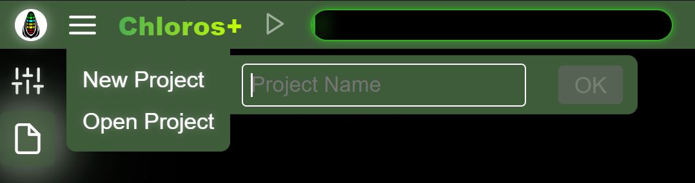

# GUI: Projekte

Mit Chloros können Sie Projekte erstellen, die später wieder geöffnet werden können.

## Neues Projekt

<figure><figcaption></figcaption></figure>Wählen Sie im Hauptmenü „Neues Projekt“ aus und geben Sie einen eindeutigen Namen für Ihr Projekt ein.

## Projekt öffnen

<figure><figcaption></figcaption></figure>Wählen Sie „Projekt öffnen“, um eine Liste der vorhandenen Projekte im Projektordner anzuzeigen. Wenn keine Projekte vorhanden sind, wird das sekundäre Seitenmenü nicht geöffnet. Auf dem obigen Foto sehen Sie einige über die Benutzeroberfläche erstellte Projekte (t1, t2, t3). Die Projekte mit dem Namen DATE\_TIME wurden von CLI unter Verwendung des Standard-Projektbenennungsschemas erstellt. Durch Klicken auf einen Projektnamen wird das Projekt geöffnet.

Durch Klicken auf die Schaltfläche „Projektordner öffnen“ wird der Datei-Explorer Ihres Computers am Projektpfad geöffnet. Sie können den Projektpfad in den [Projekteinstellungen](project-settings/project-settings.md) anpassen.

## Dateien hinzufügen

Nachdem ein Projekt geöffnet wurde, wählen Sie „Dateien hinzufügen“ aus dem Hauptmenü, um einzelne Bilddateien zum aktuellen Projekt hinzuzufügen. Dies entspricht der Hinzufügen-Funktion des Dateibrowsers, ist aber der Einfachheit halber direkt über das Hauptmenü zugänglich.

## Ordner hinzufügen

Nachdem ein Projekt geöffnet wurde, wählen Sie „Ordner hinzufügen“ aus dem Hauptmenü, um einen gesamten Ordner mit Bildern zum aktuellen Projekt hinzuzufügen. Doppelte Dateien werden ignoriert.

## Verarbeitung starten/stoppen

Nachdem Dateien zu einem Projekt hinzugefügt wurden, wird im Hauptmenü die Option „Verarbeitung starten“ verfügbar. Dies entspricht dem Klicken auf die Schaltfläche „Wiedergabe/Start“ in der oberen Kopfzeile. Während der Verarbeitung ändert sich der Menüpunkt zu „Verarbeitung stoppen“, damit Sie die Pipeline anhalten können.


Die Menüoptionen „Dateien hinzufügen“, „Ordner hinzufügen“ und „Verarbeitung starten/stoppen“ sind nur sichtbar oder aktiviert, wenn ein Projekt geöffnet ist und Dateien hinzugefügt wurden. Sie bieten schnellen Zugriff auf Aktionen, die auch über die Seitenleiste des Dateibrowsers und die Schaltflächen in der Kopfzeile verfügbar sind.

